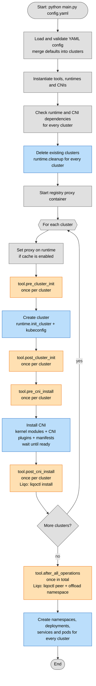

## Execution flow

Steps executed by `main.py`. Blue = Kubernetes/cluster configuration, orange = tool hooks, grey = internal steps (config, dependencies, cache).



## CNI

Runtimes always create the cluster **without** their built-in CNI (and without
kube-proxy when the CNI replaces it): the CNI is always installed by the
testbench, so that the same CNI gets the same version and parameters on every
runtime.

```yaml
cni:
  type: flannel          # flannel (default) | calico | cilium
  spec:                  # optional, validated against cnis/<type>.py
    version: "0.28.10"   # generic: CNI version
    wait: true           # generic: wait for CNI, nodes and CoreDNS to be ready
    timeout: 600         # generic: seconds to wait
    backend: vxlan       # flannel-specific
```

`cni: flannel` is a shorthand for `cni: {type: flannel}`.

| CNI | Specific parameters | Notes |
|---|---|---|
| `flannel` | `backend` (`vxlan`, `host-gw`, `wireguard`), `iface`, `enable_nftables` | Needs `br_netfilter` (loaded from the node containers on kind/k3d) and the `bridge`/`host-local`/`loopback`/`portmap` plugins (copied into the nodes on kind/k3d). |
| `calico` | `dataplane` (`Iptables`, `Nftables`, `BPF`), `encapsulation`, `block_size`, `nat_outgoing`, `mtu`, `observability` | Installed through the Tigera operator. With `BPF`, kube-proxy is disabled and the API server endpoint is given via the `kubernetes-services-endpoint` ConfigMap. |
| `cilium` | `kube_proxy_replacement`, `tunnel_protocol`, `cluster_pool_mask_size`, `mtu` | Requires the `cilium` CLI. |

Generic cluster parameters `cluster_cidr` (default `10.244.0.0/16`) and
`service_cidr` (default `10.96.0.0/16`) are validated (valid IPv4 CIDRs, no
overlap, a /24 per node) and passed to every CNI. Every CNI keeps its pods off
Liqo virtual nodes.

## TODO

- Move resources creation logic to runtime
- Check types, in some places Type[...] is wrong
- Update the output format, make it cleaner and hide the commands output if verbose is disabled
- Improve the hooks system, add more hooks (after_namespace_creation, after_deployment_creation, etc.)
- Ask before deleting the clusters, maybe with a --force flag to skip the confirmation
- The default input should just be spread to the clusters spec, without validation
