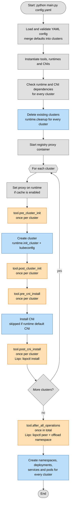

## Execution flow

Steps executed by `main.py`. Blue = Kubernetes/cluster configuration, orange = tool hooks, grey = internal steps (config, dependencies, cache).

## TODO

- Move resources creation logic to runtime
- Check types, in some places Type[...] is wrong
- Update the output format, make it cleaner and hide the commands output if verbose is disabled
- Add CNI spec
- The CNI should be optional, if not specified use the default one, otherwise install the specified one
- Improve the hooks system, add more hooks (after_namespace_creation, after_deployment_creation, etc.)
- Check why the cluster does not start without specifying the cidr in the config file
- Ask before deleting the clusters, maybe with a --force flag to skip the confirmation
- The default input should just be spread to the clusters spec, without validation
