## Execution flow

Steps executed by `main.py`. Blue = Kubernetes/cluster configuration, orange = tool hooks, grey = internal steps (config, dependencies).

```mermaid
flowchart TD
    A([Start: python main.py config.yaml]) --> B[Load and validate YAML config<br/>merge defaults into clusters]
    B --> C[Instantiate tools, runtimes and CNIs]
    C --> D[Check runtime, CNI and tool dependencies]
    D --> E[Delete existing clusters<br/>runtime.cleanup for every cluster]
    E --> F[tool.before_all_operations<br/>once in total<br/>registry_proxy: start proxy container]

    F --> L{{For each cluster}}
    L --> H[tool.pre_cluster_init<br/>once per cluster<br/>registry_proxy: runtime.set_node_proxy]
    H --> I[Create cluster<br/>runtime.init_cluster + kubeconfig]
    I --> J[tool.post_cluster_init<br/>once per cluster]
    J --> J2[tool.pre_cni_install<br/>once per cluster]
    J2 --> K[Install CNI<br/>kernel modules + CNI plugins + manifests<br/>wait until ready]
    K --> M[tool.post_cni_install<br/>once per cluster<br/>Liqo: liqoctl install]
    M --> N{More clusters?}
    N -- yes --> L
    N -- no --> O[tool.after_all_operations<br/>once in total<br/>Liqo: liqoctl peer + offload namespace]

    O --> P[Create namespaces, deployments,<br/>services and pods for every cluster]
    P --> Q([End])

    classDef internal fill:#e0e0e0,stroke:#616161,color:#000
    classDef k8s fill:#bbdefb,stroke:#1565c0,color:#000
    classDef tool fill:#ffe0b2,stroke:#ef6c00,color:#000

    class A,B,C,D,L,N,Q internal
    class E,I,K,P k8s
    class F,H,J,J2,M,O tool
```



## Runtime

Same structure as `cni`: `runtime: kind` is a shorthand for `runtime: {type: kind}`,
and `spec` is validated against `runtimes/<type>.py` (unknown fields are rejected).

```yaml
runtime:
  type: minikube         # kind | k3d | minikube
  spec:
    kubernetes_version: "1.30.0"
    driver: kvm2
```

Every runtime creates `nodes` nodes (the first is the control plane) with the
given `cluster_cidr`/`service_cidr`, labels the i-th node `tier=worker-<i>`,
and writes a kubeconfig containing only that cluster to `out/kubeconfigs/<name>.yaml`.

Runtimes contain no tool-specific logic: tools customize the cluster through
generic options set in `pre_cluster_init`, e.g. `runtime.set_node_proxy(NodeProxy)`
(the container runtime of the nodes pulls through an HTTP(S) proxy, trusting
its CA; kind/minikube configure it on every node after creation, k3d at creation).

| Runtime | Parameters | Notes |
|---|---|---|
| `kind` | `image` (default `kindest/node:v1.30.0`) | Kubernetes version = node image. |
| `k3d` | `image` (default `rancher/k3s:v1.30.2-k3s2`), `disable` (`traefik`, `servicelb`, `metrics-server`, `local-storage`) | Kubernetes version = node image. `servicelb` provides `LoadBalancer` services (used by the Liqo gateway on k3d). |
| `minikube` | `kubernetes_version` (default `1.30.0`), `driver` (`kvm2`, `docker`), `container_runtime` (`containerd`, `cri-o`, `docker`), `network`, `cpus`, `memory`, `disk_size` | `network` defaults to `testbenchnet` (libvirt, kvm2) or `kind` (docker, shared with kind/k3d and the registry proxy). Clusters must share a network to reach each other. |

`runtime.get_api_server_address()` returns the API server URL reachable from the
nodes of the other clusters (node address, not the port forwarded on the host).

## Tools

Same structure as `runtime`/`cni`: `- registry_proxy` is a shorthand for
`- {type: registry_proxy}`, and `spec` is validated against `tools/<type>.py`
(unknown fields and unknown cluster names are rejected).

### registry_proxy

Caching registry proxy ([rpardini/docker-registry-proxy](https://github.com/rpardini/docker-registry-proxy)),
shared by every cluster: the nodes of the selected clusters pull their images
through it. Cache and CA persist across runs in `out/registry-proxy`; the
container is reused, and recreated only when its configuration changes.

```yaml
tools:
  - type: registry_proxy
    spec:
      clusters: [rome]              # default: all clusters
      registries: [registry.k8s.io, quay.io, ghcr.io, gcr.io]  # cached besides Docker Hub
      manifest_cache: true
      auth:                         # upstream credentials (e.g. Docker Hub rate limit)
        - registry: auth.docker.io
          username: myuser
          password_env: DOCKERHUB_TOKEN   # env var name, not the secret
      extra_no_proxy: [example.com]
      host_port: 3128
      timeout: 120
```

The proxy runs on the `kind` docker network. It is published on the host
(`host_port`, all interfaces, so reachable from the LAN) only if a selected
cluster has nodes outside that network (minikube `kvm2`).

### liqo

See `tools/liqo.py`: `installations` (`cluster`, `version`, `offloadings`) and
`peerings` (pairs of installed clusters).

## CNI

Runtimes always create the cluster **without** their built-in CNI (and without
kube-proxy when the CNI replaces it): the CNI is always installed by the
testbench, so that the same CNI gets the same version and parameters on every
runtime.

```yaml
cni:
  type: flannel          # flannel (default) | calico | cilium
  spec:                  # optional, validated against cnis/<type>.py
    version: "0.28.10"   # generic: CNI version
    wait: true           # generic: wait for CNI, nodes and CoreDNS to be ready
    timeout: 600         # generic: seconds to wait
    backend: vxlan       # flannel-specific
```

`cni: flannel` is a shorthand for `cni: {type: flannel}`.

| CNI | Specific parameters | Notes |
|---|---|---|
| `flannel` | `backend` (`vxlan`, `host-gw`, `wireguard`), `iface`, `enable_nftables` | Needs `br_netfilter` (loaded from the node containers on kind/k3d) and the `bridge`/`host-local`/`loopback`/`portmap` plugins (copied into the nodes on kind/k3d). |
| `calico` | `dataplane` (`Iptables`, `Nftables`, `BPF`), `encapsulation`, `block_size`, `nat_outgoing`, `mtu`, `observability` | Installed through the Tigera operator. With `BPF`, kube-proxy is disabled and the API server endpoint is given via the `kubernetes-services-endpoint` ConfigMap. |
| `cilium` | `kube_proxy_replacement`, `tunnel_protocol`, `cluster_pool_mask_size`, `mtu` | Requires the `cilium` CLI. |

Generic cluster parameters `cluster_cidr` (default `10.244.0.0/16`) and
`service_cidr` (default `10.96.0.0/16`) are validated (valid IPv4 CIDRs, no
overlap, a /24 per node) and passed to every CNI.

### CNI customization from tools

CNIs contain no tool-specific configuration: a tool that needs a custom CNI
configuration registers it on the CNI instance in its `pre_cni_install` hook,
only for the clusters it cares about:

- `cni.add_node_selector_requirement(req)`: generic, supported by every CNI.
  Restricts the CNI node agents to the nodes matching a Kubernetes
  `NodeSelectorRequirement`.
- `cni.add_patch(fn)`: CNI-specific. `fn` receives the configuration generated
  by the CNI right before it is installed, and modifies it in place (returning
  `None`) or returns a new one. Patches run in registration order.

| CNI | Configuration passed to patches |
|---|---|
| `flannel` | objects of the `kube-flannel.yml` manifest (`list[dict]`), already customized with the spec |
| `calico` | Tigera operator resources: `Installation`, `APIServer`, `Goldmane`, `Whisker` (`list[dict]`) |
| `cilium` | Helm values (`dict`) |

`cnis.base.find_object(objects, kind, name)` helps locating an object in a list.

Example: on the clusters where it is installed, the Liqo tool keeps the CNI
agents off Liqo virtual nodes (`liqo.io/type DoesNotExist`) and, on Calico,
excludes the `liqo.*` interfaces from the node address autodetection.

```python
def pre_cni_install(self, settings, runtime, cni):
    cni.add_node_selector_requirement({"key": "liqo.io/type", "operator": "DoesNotExist"})
    if isinstance(cni, CalicoCNI):
        cni.add_patch(_calico_skip_liqo_interfaces)
```

## TODO

- Move resources creation logic to runtime
- Check types, in some places Type[...] is wrong
- Update the output format, make it cleaner and hide the commands output if verbose is disabled
- Improve the hooks system, add more hooks (after_namespace_creation, after_deployment_creation, etc.)
- Ask before deleting the clusters, maybe with a --force flag to skip the confirmation
- The default input should just be spread to the clusters spec, without validation
