# Developer guide

How the testbench works internally and how to extend it with new runtimes,
CNIs and tools. For the configuration format see
[configuration.md](configuration.md).

## Project layout

| Path | Content |
|---|---|
| `main.py` | Entry point: CLI arguments and the [execution flow](#execution-flow). |
| `core/input.py` | Configuration models (pydantic) and validation. |
| `core/modules.py` | Discovery of runtimes, CNIs and tools. |
| `core/workloads.py` | Creation of namespaces, manifests and workloads. |
| `core/log.py`, `core/paths.py` | Structured logging, output directory. |
| `runtimes/` | One module per runtime, base class in `runtimes/base.py`. |
| `cnis/` | One module per CNI, base class in `cnis/base.py`. |
| `tools/` | One module per tool, base class in `tools/base.py`. |
| `utils/kubernetes_utils.py` | Kubernetes API helpers (apply, wait, create). |
| `utils/kubernetes_models.py` | Validation of dicts against the Kubernetes client models. |
| `utils/commands.py` | `run_command`: execution of the external commands. |

## Components

Runtimes, CNIs and tools are discovered from their directory: every module
exporting `module` (the class) and `spec` (its pydantic parameter model) is
available under the module file name.

```python
# cnis/flannel.py -> `cni: flannel`
module = FlannelCNI
spec = FlannelCNISpec
```

The spec models subclass `BaseRuntimeSpec`, `BaseCNISpec` or `BaseToolSpec`
(unknown fields rejected) and are validated as the `spec` of
`{type: <name>, spec: {...}}`. Specs can also validate themselves against the
rest of the configuration:

- `BaseCNISpec.validate_cluster(cluster_cidr, service_cidr, nodes)`, e.g.
  Calico checks that `block_size` fits in `cluster_cidr`.
- `BaseToolSpec.validate_clusters(cluster_names)`, e.g. Liqo checks that
  installations and peerings refer to existing clusters
  (`tools.base.check_known_clusters`).

Both raise `ValueError`, reported as a configuration error.

### Runtimes

A runtime (`runtimes/base.py`, `BaseRuntime`) creates a cluster of
`settings.nodes` nodes with the given pod/service CIDRs, labels the i-th node
`tier=worker-<i>`, and writes a kubeconfig with only that cluster to
`utils.kubeconfig.get_kubeconfig_location(name)`. The cluster is always
created **without** its built-in CNI, and without kube-proxy when
`cni.replaces_kube_proxy`.

| Member | Description |
|---|---|
| `init_cluster()` | Abstract. Creates the cluster. |
| `cleanup()` | Abstract. Deletes the cluster; must not fail if it does not exist. |
| `get_api_server_address()` | Abstract. API server URL reachable from the nodes of the other clusters. |
| `check_dependencies()` | Raises if a dependency (e.g. the CLI) is missing. |
| `install_cni_plugins(plugins)` | Copies the reference CNI plugins into the nodes, if the image lacks them. |
| `load_kernel_modules(modules)` | Loads kernel modules on the nodes (container-based runtimes). |
| `on_docker_network` | Whether the nodes are on the shared `kind` docker network. |
| `provides_load_balancer` | Whether `LoadBalancer` services get a reachable address. |
| `set_node_proxy(NodeProxy)` | Generic option set by tools before `init_cluster`: the container runtime of the nodes pulls through an HTTP(S) proxy, trusting its CA. Helpers: `node_proxy_address()`, `node_no_proxy()`, `node_proxy_setup_script(service)`. |

Runtimes contain no tool-specific logic: tools customize them only through
generic options like `set_node_proxy`.

### CNIs

A CNI (`cnis/base.py`, `BaseCNI`) installs itself on an existing cluster.
`runtime.install_cni()` loads `REQUIRED_KERNEL_MODULES`, copies
`REQUIRED_CNI_PLUGINS`, calls `cni.install_cni()` and, if `spec.wait`,
`cni.wait_ready()` (waits for `WORKLOADS`, the nodes and CoreDNS).

| Member | Description |
|---|---|
| `install_cni()` | Abstract. Installs the CNI, applying the tool customizations. |
| `replaces_kube_proxy` | Whether the cluster must be created without kube-proxy. |
| `WORKLOADS` | `{namespace: [names] or None}` waited for by `wait_ready`. |
| `REQUIRED_CNI_PLUGINS`, `REQUIRED_KERNEL_MODULES` | Prerequisites provided by the runtime. |

CNIs contain no tool-specific configuration: tools register it on the CNI
instance in their `pre_cni_install` hook, only for the clusters they care
about.

- `cni.add_node_selector_requirement(req)`: generic, supported by every CNI.
  Restricts the CNI node agents to the nodes matching a Kubernetes
  `NodeSelectorRequirement` (`install_cni` uses `node_affinity()`).
- `cni.add_patch(fn)`: CNI-specific. `fn` receives the configuration
  generated by the CNI right before it is installed, and modifies it in place
  (returning `None`) or returns a new one. Patches run in registration order
  (`apply_patches`).

| CNI | Configuration passed to patches |
|---|---|
| `flannel` | Objects of the `kube-flannel.yml` manifest (`list[dict]`), already customized with the spec. |
| `calico` | Tigera operator resources: `Installation`, `APIServer`, `Goldmane`, `Whisker` (`list[dict]`). |
| `cilium` | Helm values (`dict`). |

`cnis.base.find_object(objects, kind, name)` locates an object in a list.

```python
def pre_cni_install(self, settings, runtime, cni):
    cni.add_node_selector_requirement({"key": "liqo.io/type", "operator": "DoesNotExist"})
    if isinstance(cni, CalicoCNI):
        cni.add_patch(_calico_skip_liqo_interfaces)
```

### Tools

A tool (`tools/base.py`, `BaseTool`) acts on the clusters through hooks
called by `main.py`. Every tool receives every hook, for every cluster: a
tool acting only on some clusters filters by itself (e.g. Liqo by its
`installations`). Within a hook, tools run in the order of `tools:`.

| Hook | Called | Arguments | Typical use |
|---|---|---|---|
| `check_dependencies()` | once | | Fail early on missing CLIs or env vars. |
| `before_all_operations` | once, before any cluster | `all_settings`, `all_runtimes`, `all_cnis` (by cluster name) | Shared infrastructure (registry proxy container). |
| `pre_cluster_init` | per cluster | `settings`, `runtime`, `cni` | Runtime options (`runtime.set_node_proxy`). No kubeconfig yet. |
| `post_cluster_init` | per cluster | same | Cluster up, kubeconfig written, no CNI. |
| `pre_cni_install` | per cluster | same | CNI customizations (`add_node_selector_requirement`, `add_patch`). |
| `post_cni_install` | per cluster | same | Cluster ready (`liqoctl install`). |
| `after_all_operations` | once, after every cluster | same as `before_all_operations` | Cross-cluster operations (peering, offloading). |

Workloads from the configuration are created after `after_all_operations`.

## Execution flow

Steps executed by `main.py`. Blue = Kubernetes/cluster operations, orange =
tool hooks, grey = internal steps.

```mermaid
flowchart TD
    A([Start: python main.py config.yaml]) --> B[Load and validate YAML config<br/>merge defaults, validate specs and manifests]
    B --> C[Instantiate tools, runtimes and CNIs]
    C --> D[Check runtime, CNI and tool dependencies]
    D --> E[Delete existing clusters<br/>runtime.cleanup for every cluster]
    E --> E2[Ensure the shared kind docker network]
    E2 --> F[tool.before_all_operations<br/>once in total<br/>registry_proxy: start proxy container]

    F --> L{{For each cluster}}
    L --> H[tool.pre_cluster_init<br/>registry_proxy: runtime.set_node_proxy]
    H --> I[Create cluster<br/>runtime.init_cluster + kubeconfig]
    I --> J[tool.post_cluster_init]
    J --> J2[tool.pre_cni_install<br/>Liqo: CNI customizations]
    J2 --> K[Install CNI<br/>kernel modules + CNI plugins + install<br/>wait until ready]
    K --> M[tool.post_cni_install<br/>Liqo: liqoctl install]
    M --> N{More clusters?}
    N -- yes --> L
    N -- no --> O[tool.after_all_operations<br/>once in total<br/>Liqo: liqoctl peer + offload namespaces]

    O --> P[For every cluster: namespaces, cluster manifests,<br/>then namespace manifests, deployments, services, pods]
    P --> Q([End])

    classDef internal fill:#e0e0e0,stroke:#616161,color:#000
    classDef k8s fill:#bbdefb,stroke:#1565c0,color:#000
    classDef tool fill:#ffe0b2,stroke:#ef6c00,color:#000

    class A,B,C,D,L,N,Q internal
    class E,E2,I,K,P k8s
    class F,H,J,J2,M,O tool
```



Clusters are created sequentially, in configuration order. Any exception
stops the run (clusters already created are left in place).

## Built-in tools

### registry_proxy

`before_all_operations` starts (or reuses, if its configuration did not
change) the [docker-registry-proxy](https://github.com/rpardini/docker-registry-proxy)
container on the `kind` docker network, with cache and CA in
`<out-dir>/registry-proxy`. The port is published on the host only if a
selected cluster is outside the docker network (minikube `kvm2`).
`pre_cluster_init` calls `runtime.set_node_proxy(...)` on the selected
clusters; kind and minikube configure the proxy on every node after creation,
k3d at creation.

### liqo

- `before_all_operations`: rejects clusters on unsupported runtimes.
- `pre_cni_install`: keeps the CNI agents off the Liqo virtual nodes; on
  Calico excludes the `liqo.*` interfaces from the node address
  autodetection, on Cilium sets `devices: [eth+]` unless set.
- `post_cni_install`: `liqoctl install`, retried with exponential backoff
  (`install_retry`).
- `after_all_operations`: `liqoctl peer` for each pair, then
  `liqoctl offload namespace`.

| Runtime | `liqoctl install` provider | Notes |
|---|---|---|
| `kind` | `kind` | |
| `k3d` | `k3s` | `--api-server-url` (control plane address on the docker network), `--pod-cidr`, `--service-cidr`. |
| `minikube` | `kubeadm` | CIDRs read from the kube-controller-manager; API server URL set to the node address (`--set-string apiServer.address=...`). |

The gateway of the provider is exposed through a `LoadBalancer` service if
`runtime.provides_load_balancer` (k3d unless `servicelb` is disabled),
`NodePort` otherwise.

## Configuration validation

`core/input.py` builds the configuration models with pydantic:

- `RootConfig.merge_defaults` copies the `default` fields into the clusters
  before validation. `validate_data` also validates `default` on its own,
  as a partial `ClusterConfig` (`_validate_default`: only the errors on the
  fields it sets), and drops the cluster errors on inherited fields that
  already failed in `default`: each error is reported once, where it is
  written. Cross-field checks (CIDRs, CNI vs CIDR) run per cluster only.
- `runtime`, `cni` and tools are discriminated unions on `type`, built from
  the discovered spec models (`_typed_config`).
- Pod and service specs are converted by `utils/kubernetes_models.to_model`
  into the official Kubernetes client models (`V1PodSpec`, `V1ServiceSpec`).
  The client models only check required fields and their deserializer drops
  unknown fields, so `to_model` walks `openapi_types`/`attribute_map`
  itself, collecting every unknown field, type error and missing required
  field with its path.
- Manifests are resolved against `base_dir` (directory of the configuration
  file, passed in the pydantic validation context), loaded, and their built-in
  objects validated with `to_model` (`model_name_for` maps
  `apiVersion`/`kind` to the client model).

## Adding a component

1. Create `runtimes/<name>.py`, `cnis/<name>.py` or `tools/<name>.py`.
2. Define the spec model (subclass of the base spec) and the class
   implementing the abstract methods / hooks.
3. Export them as `module` and `spec`.
4. Document the parameters in [configuration.md](configuration.md) and the
   component in the [README](../README.md).

Minimal tool:

```python
from pydantic import Field

from tools.base import BaseTool, BaseToolSpec, check_known_clusters


class HelloToolSpec(BaseToolSpec):
    clusters: list[str] = Field(default_factory=list)

    def validate_clusters(self, clusters: list[str]) -> None:
        check_known_clusters(self.clusters, clusters)


class HelloTool(BaseTool[HelloToolSpec]):
    def post_cni_install(self, settings, runtime, cni) -> None:
        if settings.name in self.spec.clusters:
            print(f"cluster {settings.name} ready, kubeconfig: {cni.kubeconfig}")


module = HelloTool
spec = HelloToolSpec
```

## Logging and output

- `log = core.log.get_logger(__name__)`, then
  `log.info("Installing Liqo", cluster=name)` or `log.bind(cluster=name)`.
  Logs go to stderr (`console` or `json` format).
- External commands run through `utils.commands.run_command`, never
  `subprocess.run` directly. With `--log-level DEBUG` the command is logged
  and its output streamed to stdout; otherwise the output is captured and
  its last lines are included in the `CommandError` raised on failure.
  `capture=True` returns the output (`result.stdout`) instead, e.g. to parse
  it.
- Generated files go to `--out-dir` (default `out`); in code use
  `core.paths.output_path(...)`.

## Tests

Unit tests in `tests/`, written with the standard `unittest` module (no
extra dependency; pytest can run them too). They need neither Docker nor a
cluster: external commands and the Kubernetes API are mocked. Run them from
the repository root (components are discovered relative to it):

```bash
uv run python -m unittest            # all
uv run python -m unittest tests.test_input -v
```

| File | Covers |
|---|---|
| `test_input.py` | Configuration validation: clusters, `default` (errors reported once), workloads, names, manifests (relative/absolute paths), tools, examples. |
| `test_kubernetes_models.py` | Conversion and validation against the Kubernetes client models. |
| `test_cnis.py` | CNI configuration generation, tool customizations (affinity, patches), CNI-specific validation. |
| `test_runtimes.py` | kind/k3d configuration, minikube arguments, node proxy. |
| `test_liqo.py` | Liqo spec validation, CNI customizations, `liqoctl` commands, retries. |
| `test_commands.py` | `run_command`: output capture, errors. |
| `test_retry.py` | Exponential backoff. |
| `test_workloads.py` | Workload creation order, Kubernetes objects, manifest namespaces. |

`tests/helpers.py` provides `make_settings`, `cluster` and
`ValidationTestCase` (validates raw configurations in a temporary directory
and captures the reported errors).
